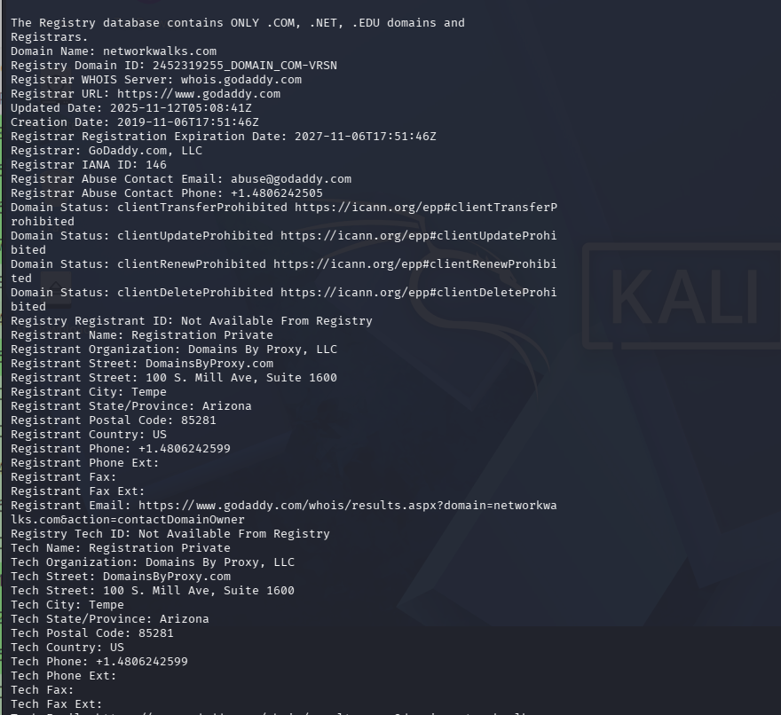
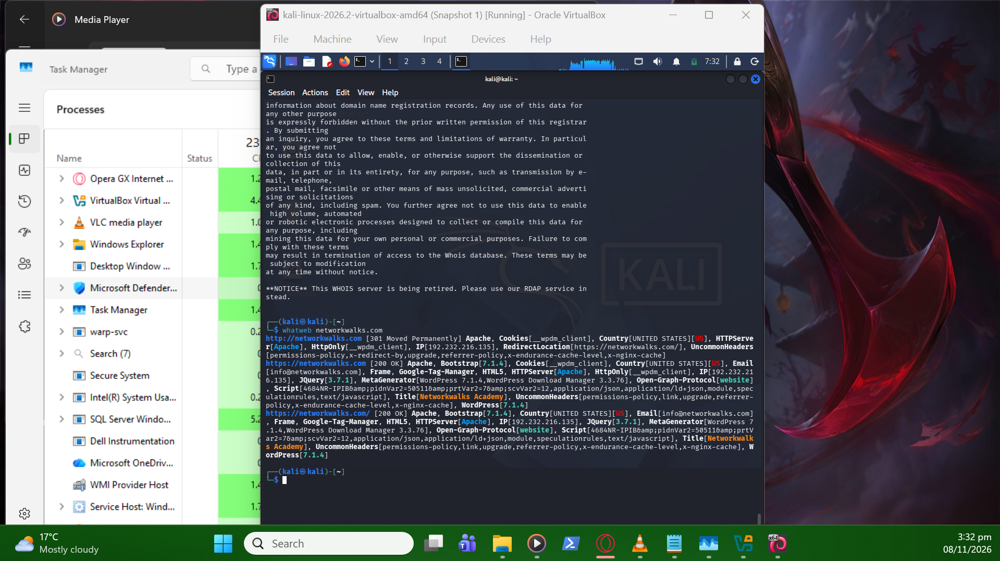
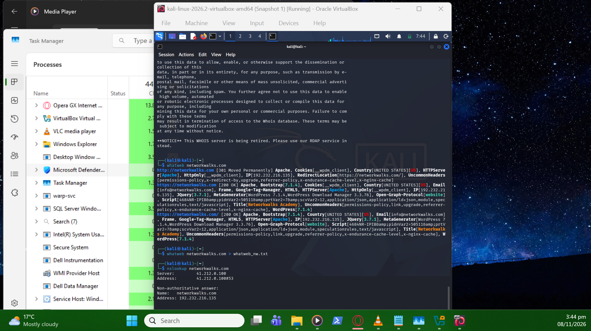
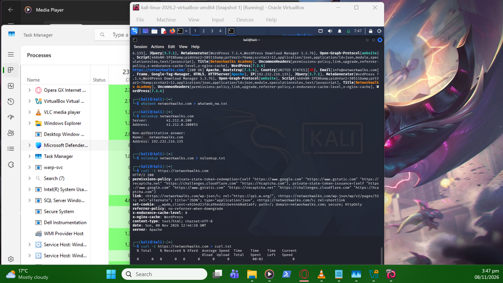
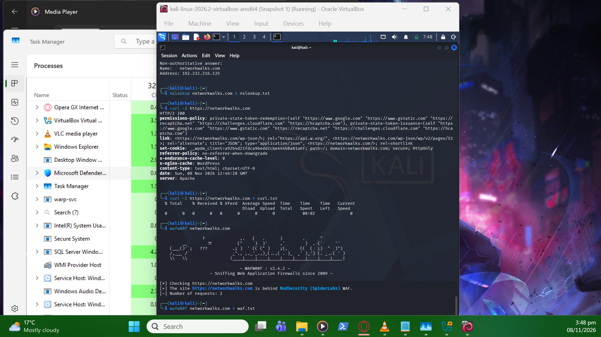
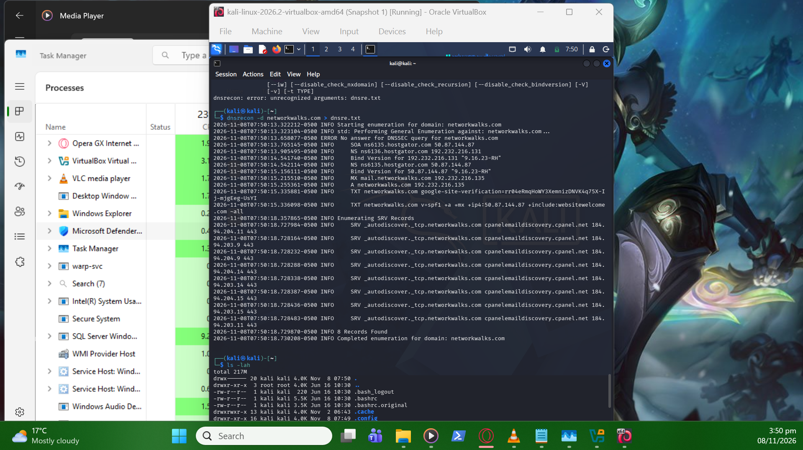

# Week 2 - Project Module 1: Footprinting & Reconnaissance

## Overview
In this lab, I acted as an ethical hacker performing passive reconnaissance (footprinting) against the authorized target `networkwalks.com`. Using six built-in Kali Linux tools, I gathered public information to build a profile of the target's infrastructure, web technologies, and security posture without alerting the target.

## Tools & Tasks Performed

### Task 1: WHOIS (Domain Registration Details)
* **Command:** `whois networkwalks.com`
* **Objective:** Identify the domain owner, registrar (GoDaddy), creation date, and name servers (HostGator).
* **Screenshot:**
  

### Task 2: WhatWeb (Web Technology Fingerprinting)
* **Command:** `whatweb networkwalks.com`
* **Objective:** Identify the underlying software stack, revealing WordPress 7.0.4, WP Download Manager 3.3.58, and the server IP.
* **Screenshot:**
  

### Task 3: NSLookup (DNS Resolution)
* **Command:** `nslookup networkwalks.com`
* **Objective:** Resolve the domain to its real IP address (192.232.216.135) and identify the authoritative name server.
* **Screenshot:**
  

### Task 4: Curl (HTTP Response Headers)
* **Command:** `curl -I https://networkwalks.com`
* **Objective:** Read HTTP headers to find server banners, caching stacks, and hidden endpoints (like the WordPress REST API).
* **Screenshot:**
  

### Task 5: WAFW00F (Web Application Firewall Detection)
* **Command:** `wafw00f networkwalks.com`
* **Objective:** Detect if a firewall is protecting the site. The tool successfully identified ModSecurity (SpiderLabs) WAF.
* **Screenshot:**
  

### Task 6: DNSRecon (DNS Enumeration)
* **Command:** `dnsrecon -d networkwalks.com`
* **Objective:** Enumerate all DNS records including SOA, NS, MX, and TXT records to map the target's infrastructure.
* **Screenshot:**
  

## Key Takeaways
* **Information Leakage:** Publicly available data (like software versions) gives attackers a massive advantage in finding known vulnerabilities.
* **Defense:** Defenders should run these exact same tools against their own domains to see what information they are accidentally leaking to the public.
